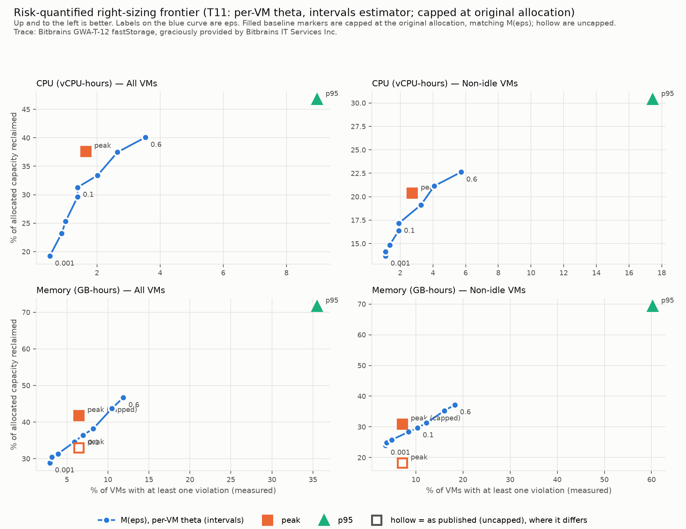
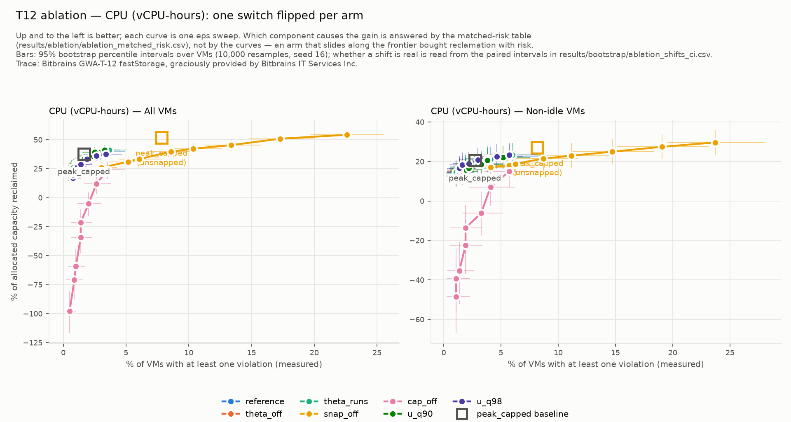
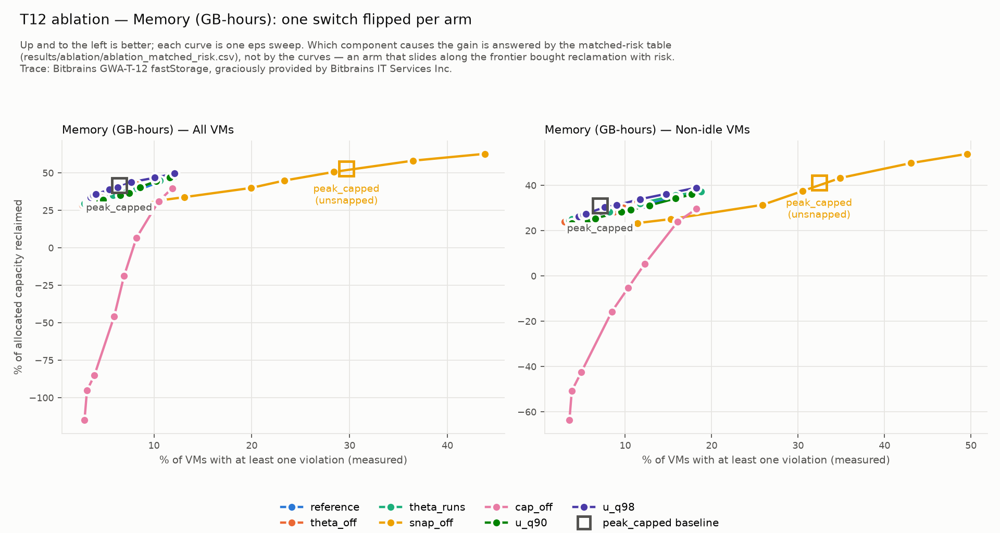
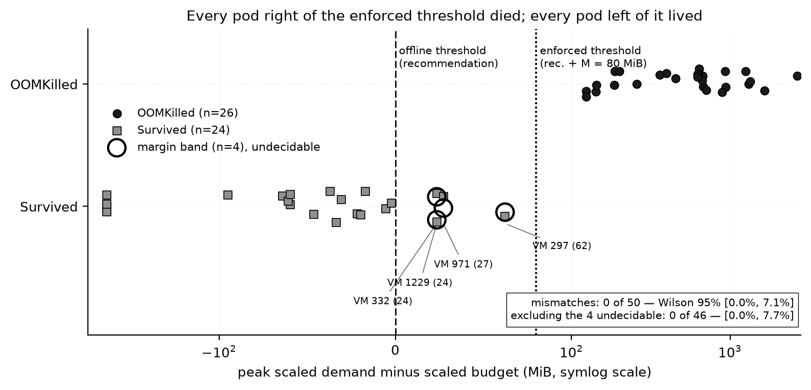

# Pricing the Risk of VM Right-Sizing: A Measurement Protocol, and What It Found in an Extreme-Value Recommender

*[Authors]*

*Draft, 2026-10-22. Every number cites a tracked file under `results/` or
`evidence/`. Figure paths are relative to this file.*

## Abstract

Right-sizing tools report the capacity they reclaim, but not the risk they
take on to get it. We pre-registered three falsifiable hypotheses for an
extreme-value recommender, M(eps), on 792 VMs of the Bitbrains GWA-T-12
fastStorage trace. We then evaluated it under a measurement protocol with four
parts: comparison at matched *measured* risk, VM-level bootstrap intervals
(B = 10,000), sensitivity across six observation/evaluation splits, and kernel
validation of the offline violation definition on 50 replayed containers.

No hypothesis is supported.

- **H1** (dominance over P95 at matched risk) is not evaluable. The M(eps)
  curve never reaches P95's measured risk: 0.035 against 0.090 on CPU, and
  0.119 against 0.355 on memory.
- **H2** (calibration) is rejected in every scope, resource and split.
- **H3** (zero-risk reclamation) finds 0%.

Against a like-for-like capped peak baseline at matched risk, M(eps) reclaims
2.2 to 6.3 percentage points less. The ablation traces all of its gain to a
cap at the original allocation, not to the tail model. The same protocol also
withdrew five claims we had made at an interim review, and we report them as
corrections.

Our contribution is the protocol, not the method.

## 1 Introduction

A VM is sized once, against a peak someone guessed. Right-sizing shrinks it
towards observed use, and every unit reclaimed is paid for with headroom: a
higher chance that future demand exceeds the allocation. Current tools report
the saving and leave the risk unpriced, so an operator cannot tell a safe
recommendation from a reckless one that reclaims the same capacity.

The obvious remedy is a recommender that takes a risk target eps and returns
the smallest allocation meeting it. We built one. The contribution of this
paper, however, is the **measurement discipline** we evaluated it under. That
discipline has four parts:

1. **Matched-risk comparison.** Methods are compared at equal *measured*
   violation rate, never at equal aggressiveness, so a method cannot win by
   taking more risk.
2. **VM-level bootstrap intervals** on every reclamation figure, violation
   fraction, gap and ablation shift. A resampled gap that is undefined is
   reported as undefined, not dropped.
3. **Multi-split sensitivity.** We re-ran everything on five further
   observation/evaluation splits. This covers the axis the bootstrap holds
   fixed.
4. **Kernel validation of the violation definition.** We replayed demand in
   containers under real cgroup limits and checked the offline rule against
   the kernel's OOM killer.

This protocol caught **five false positives of our own**: claims made at an
interim review that did not survive it (§6). M(eps) is what we applied the
discipline to. Its three negative verdicts (§5.1) are evidence that the
discipline works, not caveats on it. A weaker protocol would have reported an
effect from the dependence correction, a resource-specific threshold effect,
a 29x miscalibration figure standing in for a pre-registered test, a drift
"diagnosis" that holds by construction, and a matched-risk deficit on four
cells where the data supports three.

## 2 Related work

The Review 1 gap table covers 15 works. We group them by what they report.
The gap they share is what they leave out. None of them measures the
violation rate its own sizing decisions induce, as a function of a risk level
the operator chose.

**Characterisation.** Fleet studies quantify the gap between allocation and
use in private and public clouds [1, 2]. Coach exploits temporal patterns to
oversubscribe CPU and memory on Azure hosts [3]. The first two are
descriptive and propose no sizing policy. Coach pools risk at the host, where
the platform absorbs it, instead of exposing it to the operator of each VM.

**Forecast-driven recommendation.** RSR attaches conformal prediction
intervals to VM right-sizing recommendations [4]. CLOUDADV sizes instances
with a zero-shot foundation model under drift [5]. Kollu et al. compare deep
forecasters on the GWA-T-12 trace we use [6]. RSR stops at interval coverage
and Kollu et al. at forecast accuracy. Neither replays an allocation against
held-out demand, so exhaustion events go uncounted. CLOUDADV returns a single
operating point with no risk axis.

**Uncertainty-aware autoscaling.** MagicScaler puts a stochastic QoS
constraint into its loss [7]. OptScaler adds a robustness margin to combined
predictive and reactive control [8]. AQUATOPE uses Bayesian neural networks
for serverless workflows [9], and AWARE trains a reinforcement-learning
autoscaler under safety constraints [10]. AAPA [11] and BACC [12] calibrate
prediction intervals for serverless and horizontal autoscaling. In each, risk
is a constraint, a loss term or a coverage target. None states a probability
for a decision and then checks it against the violations that decision
causes. That check is what we pre-registered as H2 (`docs/HYPOTHESES.txt`).
MagicScaler is the closest. It draws its trade-off against cost rather than
reclaimed capacity and does not validate calibration. Most of this group
also scales replicas or sub-second functions, not a static per-VM flavour
over a multi-day window.

**SLA-driven thresholds.** Pozdniakova et al. search for the single HPA
utilisation threshold that meets an SLA [13]. Erms enforces latency SLAs for
shared microservices through scheduling [14]. Either way the operator gets
one answer, not a savings-against-risk curve to choose from.

**Pre-2021 production anchors.** Autopilot sizes container limits at Google [15]. It
reports slack and OOM rate, but as separate outcomes of one tuned policy,
never as a frontier. Harvest VMs give SLOs on spare cores [16], with the
risk borne by the harvester, not by a workload being shrunk.

Two features of our protocol answer these gaps. Methods are compared at
matched measured risk along a frontier (§5.2). We also validate the offline
violation count against what a kernel enforces (§5.4).

Our tail model is standard peaks-over-threshold extreme-value theory: a
Generalized Pareto fit above a high threshold [17, 18], with an
extremal-index correction for clustered exceedances [19]. Our uncertainty
quantification uses the nonparametric bootstrap [20] and Wilson score
intervals [21]. Our calibration error follows the ECE of [22]. The trace is
Bitbrains GWA-T-12 [23].

## 3 Setup and pre-registration

**Table 1. Experimental setup.**

| Item | Setting |
|---|---|
| Trace | GWA-T-12 fastStorage: 1,250 files, 792 usable (425 idle / 367 non-idle); 300 s sampling; every usable VM spans 30.0 days |
| Split | 21-day observation, 9-day evaluation, by wall-clock time |
| Catalog | vCPU {1,2,4,8,16}; memory {2,4,8,16,32,64} GB; always snapped upward |
| Violation | memory: any single sample (terminal, the process dies); CPU: at least 2 consecutive samples (degrading) |
| Baselines | B0 as-provisioned; B1 peak; B2 P95; `peak_capped`, B1 capped at the original allocation (diagnostic) |
| Thresholds | H1 +15% vCPU-h / +10% GB-h; H3 25% / 20%; H2 ECE < 0.05 over eps ∈ {0.001, 0.005, 0.01, 0.05, 0.10}; fixed before the full-fleet run, unmoved since |
| Testbed | kind, 5 waves of containers, scale S = 1/16, 80 MiB agent margin |

458 files are excluded at the first gate they fail: 103 bad CPU capacity,
347 below the catalog floor, 2 with a mid-trace capacity shift, 6 with a
short span. Recommenders see only the observation window, and no parameter is
fitted on the evaluation window. `peak_capped` is there because upward
snapping pushes `peak` above the original allocation on 210 VMs for memory,
understating its reclamation (33.03% rather than 41.81%).

*Sources:* `evidence/02_preflight.txt` (counts, sampling, span);
`results/baseline_summary.csv` (idle split);
`evidence/10_frontier_theta_intervals.txt` (210 capped VMs; `peak` and
`peak_capped` reclamation); `docs/HYPOTHESES.txt` (thresholds);
`evidence/T8_confusion.md` (testbed).

## 4 Method: M(eps)

For each VM and resource, M(eps) (1) **fits** a Generalized Pareto
distribution above the observation-window q0.95, with the shape xi
unconstrained so that mis-specification shows in the output; (2) **corrects
for clustering** with the extremal index theta from the intervals estimator
[19], which has no free parameter (runs declustering at a pre-fixed run
length of 12 samples is the sensitivity check); (3) **converts the target**
to a per-sample `p = 1 − (1 − eps)^(1/(theta · n_eval))`, with n_eval derived
from the *observation* window's median sampling gap; and (4) **allocates** by
inverting the tail at p, snapping up to the catalog and capping at the
original allocation.

**The cap** follows from the data model: demand is clipped to the original
allocation on load, so `P(demand > a_orig) = 0`. It was decided before any
frontier was computed (`ARCHITECTURE.md`, "The cap at the original
allocation"), and the count of capped VMs is a mis-specification diagnostic.

**Fits.** 152 of 652 CPU fits and 41 of 792 memory fits have xi ≥ 1
(infinite mean; the CPU maximum is 16.58). CPU falls back to the observation
peak on 140 VMs with too few exceedances. Median theta is 0.251 for CPU and
0.562 for memory, cutting median effective trials from 2,592 to 660 and
1,456. The sweep covers eps ∈ {0.001, 0.005, 0.01, 0.05, 0.1, 0.2, 0.4, 0.6},
scored by the same tested violation functions as the baselines.

*Sources:* `evidence/07_frontier_snapped.txt` (shape counts);
`evidence/10_frontier_theta_intervals.txt` (theta, effective trials,
fallbacks).

## 5 Evaluation

### 5.1 Hypothesis verdicts

**Table 2. Pre-registered hypotheses.** Results use the headline frontier
(per-VM theta, snapped, capped, 21/9 split).

| H | Statistic | Threshold | Value | Verdict | Diagnosed mechanism |
|---|---|---|---|---|---|
| H1 | M(eps) reclamation at P95's measured risk | +15% vCPU-h, +10% GB-h | no matched point: P95 risk 0.0897 CPU / 0.3548 mem; M(eps) maximum 0.0354 / 0.1187 at eps = 0.6 | **Not evaluable** | Per-sample targets are far more extreme than P95's 1-in-20 |
| H2 | points outside the 95% binomial interval of eps; ECE | < 2 points outside; ECE < 0.05 | CPU 3/5, 3/5; mem 4/5, 4/5 (all / non-idle); ECE 0.025–0.029 | **Not supported** | Demand leaves the observed range |
| H3 | largest reclamation with zero violation events | 25% vCPU-h, 20% GB-h | 0% (only B0) | **Not supported** | A minority of VMs violates at any reduction |

*Sources:* `results/bootstrap/frontier_reference_ci.csv` (H1 risks);
`results/hypotheses/h2_summary.csv`, `h2_calibration.csv`, `h3_zero_risk.csv`;
`evidence/15_hypotheses.txt`; `evidence/09_low_eps_diagnostic.txt`
(feasibility).

**H1.** At theta = 1 and eps = 0.6, the per-sample target is 3.53e-4, a
1-in-2,829 quantile. Reaching P95's 1-in-20 would require
eps = 1 − 1.8e-58. Even at theta = 0.05, matching P95 needs eps = 0.9987. H1
was not reformulated, its comparator was not changed, and the sweep was not
extended.

**H2.** The measured-risk curve is far flatter than the target:
anti-conservative at low eps and conservative at high eps. Memory at
eps = 0.001 measures 0.029 (23 VMs). CPU saturates at 11 VMs for both
eps = 0.05 and 0.10. The binomial leg carries the verdict. The ECE leg passes
but cannot reject on this sweep (§7). The pre-registered suspect, serial
correlation, is not supported: switching the correction off has no
detectable effect (§5.3). The verdicts are identical under runs declustering
and under theta = 1.

**H3.** The nearest misses are M(eps = 0.001), which reclaims 19.2% of
vCPU-hours with 4 VMs violating and 28.9% of GB-hours with 23 VMs violating.
For non-idle VMs the nearest misses are 14.2% (4 VMs) and 24.0% (13 VMs).

**Across splits.** H2 is rejected in all six splits and all four cells, with
2 to 5 of 5 points outside the interval. ECE exceeds 0.05 in only one cell
(B7 non-idle memory, 0.097). At eps = 0.001, memory risk runs 19x to 30x the
target in every 14-day and 21-day split.
*Sources:* `results/multisplit/h2_ece.csv`, `results/multisplit/summary.csv`.

### 5.2 Comparative frontier at matched risk

**Figure 1.** Measured risk against reclamation for M(eps) and the baselines,
with 95% bootstrap intervals on both axes (`figures/frontier_theta_intervals.png`).

H1's comparator is out of reach, so we compare against the baseline that the
frontier does overlap: `peak_capped`. This comparison is **exploratory and is
not H1**. Each matched point is a linear interpolation between the two
bracketing eps values.

**Table 3. M(eps) minus `peak_capped` reclamation at `peak_capped`'s measured
risk (pp).**

| Cell | `peak_capped` risk / reclamation | Gap | 95% interval | Undefined share | Splits A0–A3 | B7 |
|---|---|---|---|---|---|---|
| all VMs, CPU | 0.0164 / 37.70 [33.30, 41.99] | −5.56 | [−11.07, −2.47] | 0 | −6.21 to −4.40 | −4.85 |
| all VMs, mem | 0.0644 / 41.81 [33.34, 49.62] | −6.30 | [−9.18, −3.45] | 0 | −7.09 to −2.97 | −1.97 |
| non-idle, CPU | 0.0273 / 20.49 [14.42, 26.65] | −2.15 | withheld; conditional [−4.02, 0.30] | 0.0001 | −4.70 to −1.85 | −1.69 |
| non-idle, mem | 0.0708 / 30.97 [15.94, 43.47] | −3.61 | [−5.71, −1.66] | 0 | −4.19 to −1.72 | −1.00 |

*Sources:* `results/theta_intervals/exploratory_matched_risk.csv`;
`results/bootstrap/matched_risk_gaps_ci.csv`;
`results/bootstrap/frontier_reference_ci.csv`;
`results/multisplit/matched_risk_gaps_summary.csv`.

M(eps) reclaims less than `peak_capped` at matched risk. On three cells the
95% interval excludes zero. On non-idle CPU the strict interval is withheld,
because the gap is undefined in 1 of 10,000 resamples, and the conditional
interval reaches zero.

The sign is negative in every split and every cell. That is consistency
across correlated windows, not an interval, and it does not upgrade the
non-idle CPU cell. No M(eps) point dominates any baseline
(`results/theta_intervals/dominance.csv`).

### 5.3 Ablation

**Figure 2.** All seven ablation arms on measured risk against reclamation
(`figures/ablation_cpu.png`, `figures/ablation_mem.png`). An arm that sits
above the reference curve can still be level with it or behind it at matched
risk.

**Table 4. Paired shift in the matched-risk gap against the reference arm
(pp; positive means flipping the switch helped).** Values in brackets are 95%
intervals. *c* marks a conditional interval, given where the strict one is
withheld, with the undefined share in parentheses. **Bold** intervals exclude
zero.

| Arm | CPU all | CPU non-idle | mem all | mem non-idle |
|---|---|---|---|---|
| theta_off | +0.70 *c* [−1.67, 4.61] (0.40) | n/a *c* [−1.14, 0.95] (0.87) | +0.93 *c* [−0.33, 3.90] (0.012) | +0.16 [−0.79, 0.96] |
| theta_runs | +0.35 [−0.63, 3.71] | −0.22 *c* [−0.94, 1.65] | +0.38 [−0.34, 1.56] | +0.28 [−0.31, 0.83] |
| snap_off† | **−8.50 [−13.45, −2.47]** | −3.92 *c* [−7.61, −2.04] | **+5.47 [1.80, 9.08]** | +2.54 [−3.31, 7.64] |
| cap_off | **−47.03 [−79.53, −30.62]** | −27.49 *c* [−36.91, −12.54] | **−67.84 [−99.14, −34.79]** | **−53.44 [−75.30, −34.17]** |
| u_q90 | +1.20 [−0.87, 3.66] | −0.72 *c* [−2.61, 1.21] | −0.56 [−1.80, 1.11] | −1.41 [−3.47, 0.01] |
| u_q98 | −1.09 [−5.01, 2.26] | +1.83 *c* [−0.41, 3.56] | **+5.26 [3.40, 7.62]** | **+2.26 [0.76, 3.90]** |

† The baseline also moves in this arm, so it is not directly comparable.
*Sources:* `results/bootstrap/ablation_shifts_ci.csv`; `evidence/13_ablation.txt`.

**The cap is the whole gain.** Every cap_off interval lies at least 30 pp
below zero. Without the cap, matched-risk reclamation goes negative
(−32.3% of GB-hours, all VMs): the fitted tail asks for more capacity than
the VM ever had. This is not flattering to M(eps). The cap comes from the
data model, not from extreme-value theory.

**The dependence correction** has no detectable effect.

**The threshold matters on memory only.** Raising it to q0.98 adds 5.26 pp of
memory reclamation, and its CPU effect cannot be told from zero. q0.95 stays
the setting, because choosing q0.98 from this table would be fitting on the
evaluation window.

**Snapping.** Turning it off narrows the memory gap. This is consistent with
our earlier finding that 17.0% of the peak-versus-P95 memory gap is catalog
quantisation, measured on the baselines alone (`results/unsnapped/`).

### 5.4 Offline definition against the kernel

**Figure 3.** Offline prediction against kernel outcome for 50 replayed VMs
(`figures/fig5_t8_validation_ci.png`).

Compared naively, the memory rule against the recommendation gives 26 true
positives, 4 false negatives, 0 false positives and 20 true negatives. All 4
false negatives sit in the band between the recommendation and the enforced
limit (recommendation plus the 80 MiB agent margin), so this testbed cannot
adjudicate them.

Compared like with like, peak demand against the enforced limit reproduces
the kernel's verdict on **50 of 50 VMs**. That bounds the true mismatch rate
below 7.1% (Wilson 95%).

The CPU axis is **not** validated at S = 1/16, and the kernel's own throttle
counters show why. We rescored wave 1 (n = 14) from each container's
`cpu.stat`, a signal the kernel accounts independently of the agent, and found
an inversion rather than a weak correlation. VM 332 never exceeds its CPU
allocation in any of 2,591 samples (peak 0.0269 of a 0.0625-core limit), yet
it is throttled in every period of **97.7%** of its sampling slices. That is
the highest rate of any uncensored pod. VM 951 genuinely exceeds its
allocation (peak 0.1331 cores, 213% of the limit) and is throttled in only
**11.4%**. The pod that most exceeds its CPU allocation is throttled least, so
no threshold on a monotone throttle statistic can recover the right ordering.

The mechanism is the harness. At S = 1/16 the quota is 6,250 µs per 100 ms
period, and the agent's non-CPU work exceeds it unaided: touching every page
of a buffer of up to hundreds of MiB each sample, plus logging and interpreter
overhead. Across the 10 uncensored pods, throttle rate correlates more with
peak memory demand (+0.553) than with CPU demand relative to the limit
(+0.407). The CPU signal measured the harness, not the workload. This is a
scale limitation with a known mechanism, not a null result about M(eps), and
the CPU violation definition itself is not in question.

*Sources:* `evidence/T8_confusion.md`; `figures/CAPTIONS.md` (Figure 5
interval); `results/wave1_cpu_rescore.csv` (per-VM throttle rates,
`pct_saturated`); `ENVIRONMENT_NOTES.md` (2026-09-08 CPU rescoring).

## 6 Corrections to the interim review

Five claims made at Review 2 are withdrawn. In each case, a part of the
protocol that came later caught a claim stronger than the evidence. The
original text stays in the repository, with a pointer to its correction.

**Table 5. Corrections to Review 2 claims.**

| # | Review 2 said | Caught by | Evidence | Replacement |
|---|---|---|---|---|
| 1 | Turning the dependence correction off is "marginally ahead" (+0.16 to +0.93 pp) | Bootstrap, paired | Every theta_off interval contains zero; CPU all VMs undefined in 40% of resamples | No detectable effect at matched risk. Its reclamation gain at fixed eps is bought with risk |
| 2 | u = q0.98 is "inconsistent across resources" (+5.26 mem, −1.09 CPU) | Bootstrap, paired | CPU all −1.09 [−5.01, 2.26]; CPU non-idle +1.83, conditional [−0.41, 3.56] | Improves memory (+5.26 [3.40, 7.62]); CPU effect indistinguishable from zero |
| 3 | Memory is 29x anti-conservative at eps = 0.001, cited as calibration evidence | Pre-registered statistic | The ratio is not the pre-registered test. The test gives 4 of 5 points outside the interval, with ECE 0.025 inside its bound | The binomial leg carries H2; 29x is a description of one point |
| 4 | "21 of 21 low-eps memory violators drift"; the low end fails because of drift | Multi-split, plus a check on how the allocation is built | Holds 0 exceptions in every split, but is near-true by construction | See below |
| 5 | M(eps) reclaims less than `peak_capped` at matched risk on all four cells | Conditional bootstrap interval | Non-idle CPU −2.15, withheld at 1 resample in 10,000; conditional [−4.02, 0.30] | Holds on three of four cells; the fourth is a point estimate whose interval reaches zero |

*Sources:* `results/bootstrap/ablation_shifts_ci.csv` (1, 2);
`results/theta_intervals/eps_calibration.csv` and
`results/hypotheses/h2_summary.csv` (3);
`results/multisplit/drift_summary.csv` and `drift_violators.csv` (4);
`results/bootstrap/matched_risk_gaps_ci.csv` (5).

**Corrections 1, 2 and 5 are significance errors.** Each read a point
estimate as an effect. Without the bootstrap they would stand, because the
point estimates are reproducible to the last digit and only their intervals
reveal them.

**Correction 3 is a substitution error.** A striking descriptive ratio
stood in for the statistic we had pre-registered. The verdict does not change,
but the reason for it does: the ECE leg, which passes, cannot reject on this
sweep (§7).

**Correction 4: the drift identity.** At eps = 0.001 the allocation is at or
above the observation-window peak for all but 1 to 3 VMs, in every split and
configuration. This check is recorded in `ENVIRONMENT_NOTES.md` (T17); its
counts are not in a tracked CSV. For every other VM, a violation means
evaluation demand exceeded the observation peak, *by construction*. So
"every violator drifted" could only have been falsified by those 1 to 3 VMs.
The same applies to the count of violations above a bounded tail's endpoint.

Four findings do survive the correction, and none of them holds by
construction:

- Strict-end violations occur in every split: 13 to 24 memory violators at
  theta = 1 in the 14- and 21-day splits, and 45 at 7 days.
- Exceeding the observation peak is common: 235 to 305 VMs on memory (30% to
  38%), and 402 at 7 days.
- Violating exceedances are large: the median ratio of evaluation peak to
  observation peak is 2.4x to 3.5x, and the maximum is 18x to 39x (73x at
  7 days).
- The violators are not a fixed set. Only 8 of A0's 17 are headline
  violators, against 20 of A3's 24, and A3 shares the headline's evaluation
  window.

Our replacement wording: the method fails exactly when demand leaves the
observed range, and that happens to 35% to 38% of VMs in every 14-day split
(30% in the 21-day headline). It describes *where* the method fails, not *why*
demand went there.

## 7 Threats to validity and limitations

**The bootstrap covers fleet composition only.** It holds the 21/9 split
fixed and treats VMs as independent, so a demand shock shared across VMs is
not represented. The multi-split analysis covers the split axis. Its splits
overlap, however (neighbouring evaluation windows share 74% of their days), so
the spread across splits is a lower bound on split sensitivity. It is not an
interval, and none is built on it.

**The ECE bound has no power here.** A recommender that never violates scores
ECE = mean(eps) = 0.0332, inside the 0.05 bound. Only the binomial leg
discriminates.

**A flag that is accepted but ignored manufactures a confident null.** The
sweep once accepted `--threshold-q`, recorded it, and did not apply it. Had
that bug survived, the threshold ablation would have printed three identical
arms, and they would have read as robust insensitivity. Every swept
parameter now has a test that it changes the output. A test of that kind
still cannot show that a parameter reaches the *right* stage of the pipeline.

**Testbed scale.** At S = 1/16 the cluster validates memory enforcement and
when violations fire. It does not validate CPU (§5.4) or absolute reclaimed
capacity, which comes from the offline run at full scale.

**Provenance.** The decisions about the cap, the run length and the threshold
are dated in project documents, not ordered by commits. The M(eps) phase
before T11 was committed as a single unit.

**Replication.** The pre-registered replication set, the Azure public VM
trace, has no memory demand time series, so it cannot replicate any memory
claim (`TASKS.md`, Phase 3 decisions). Replication on GWA-T-12 Rnd is pending
and is scheduled after this draft. <!-- T18: replace this sentence if Rnd lands. -->

## 8 Conclusion

An extreme-value recommender, evaluated honestly, failed all three of its
pre-registered hypotheses. It cannot reach the baseline's risk level. It is
not calibrated. It reclaims nothing at zero risk. At the risk levels it shares
with a capped peak baseline, it reclaims less, and its whole measurable gain
comes from a cap the data model imposes. The low end fails when demand leaves
the observed range, which no tail model addresses.

The same protocol that produced these verdicts withdrew five of our own
interim claims. Matched-risk comparison, intervals that report undefinedness,
split sensitivity and kernel validation together form a protocol any
right-sizing claim can be held to.

## Reproducibility and acknowledgement

`make demo` runs the full offline pipeline on synthetic traces in 31 s
(`evidence/19_demo.txt`). Every random step is seeded. The bootstrap uses
seed 16 and B = 10,000 (`results/bootstrap/run_config.json`). Run
configurations are logged beside their results.

This trace was graciously provided by Bitbrains IT Services Inc.

## References

1. Qin et al. How different are the cloud workloads? Characterizing
   large-scale private and public cloud workloads. IEEE/IFIP DSN 2023.
2. Towards workload-aware cloud efficiency: a large-scale empirical study of
   cloud workload characteristics. ACM, 2025.
3. Coach: exploiting temporal patterns for all-resource oversubscription in
   cloud platforms. arXiv:2501.11179, 2025. Preprint.
4. Majd, Cheng, Pahlevan and Meinel. Right-sizing recommendations (RSR):
   cloud workload conformal prediction for VMs in data center operations.
   IEEE/WIC WI-IAT 2025.
5. CLOUDADV: decision-aligned instance sizing with zero-shot foundation
   models under drift. arXiv:2606.31470, 2026. Preprint.
6. Kollu et al. Comparative analysis of cloud resources forecasting using
   deep learning techniques based on VM workload traces. Transactions on
   Emerging Telecommunications Technologies 35(1):e4933, 2024.
7. Z. Pan et al. MagicScaler: uncertainty-aware, predictive autoscaling.
   PVLDB 16(12):3808-3821, 2023. doi:10.14778/3611540.3611566.
8. Zou et al. OptScaler: a collaborative framework for robust autoscaling in
   the cloud. PVLDB 17(12), 2024.
9. Zhou, Zhang and Delimitrou. AQUATOPE: QoS-and-uncertainty-aware resource
   management for multi-stage serverless workflows. ASPLOS 2023.
10. Qiu et al. AWARE: automate workload autoscaling with reinforcement
    learning in production cloud systems. USENIX ATC 2023, pp. 315-330.
11. Zhang et al. AAPA: an archetype-aware predictive autoscaler with
    uncertainty quantification for serverless workloads on Kubernetes.
    arXiv:2507.05653, 2025. Preprint.
12. BACC: budget-aware calibration and control for horizontal autoscaling.
    arXiv:2606.20575, 2026. Preprint.
13. Pozdniakova, Mazeika and Cholomskis. SLA-adaptive threshold adjustment
    for a Kubernetes horizontal pod autoscaler. Electronics 13(7):1242, 2024.
14. Luo et al. Erms: efficient resource management for shared microservices
    with SLA guarantees. ASPLOS 2023, pp. 62-77.
15. K. Rzadca et al. Autopilot: workload autoscaling at Google. EuroSys 2020,
    pp. 1-16. Pre-2021 anchor.
16. Ambati et al. Providing SLOs for resource-harvesting VMs in cloud
    platforms. USENIX OSDI 2020, pp. 735-751. Pre-2021 anchor.
17. J. Pickands. Statistical inference using extreme order statistics. Annals
    of Statistics 3(1), 1975.
18. S. Coles. An Introduction to Statistical Modeling of Extreme Values.
    Springer, 2001.
19. C. A. T. Ferro and J. Segers. Inference for clusters of extreme values.
    JRSS B 65(2), 2003.
20. B. Efron and R. J. Tibshirani. An Introduction to the Bootstrap. Chapman &
    Hall, 1993.
21. E. B. Wilson. Probable inference, the law of succession, and statistical
    inference. JASA 22(158), 1927.
22. C. Guo et al. On calibration of modern neural networks. ICML 2017.
23. S. Shen, V. van Beek and A. Iosup. Statistical characterization of
    business-critical workloads hosted in cloud datacenters. CCGrid 2015.
